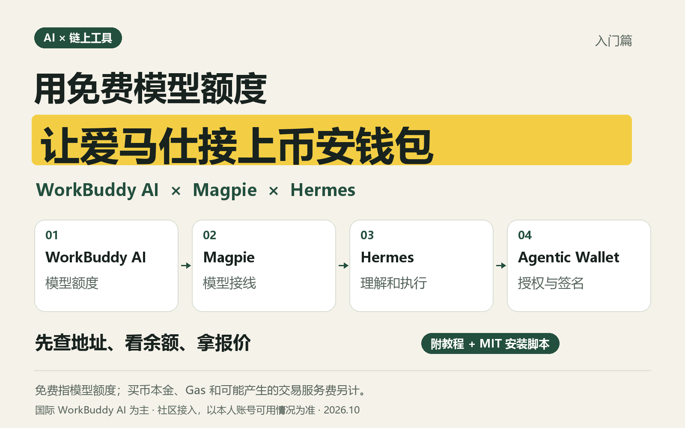

# 用免费额度，把币安 Agentic Wallet 接到 Hermes

**WorkBuddy AI → Magpie → Hermes（爱马仕）→ Binance Agentic Wallet。**

WorkBuddy AI 提供模型，Magpie 把模型接给 Hermes，Hermes 按你的指令调用币安官方钱包工具。你在币安 App 扫码授权，不需要把钱包私钥交给 AI。

这是独立社区入门项目，采用 MIT 开源许可。它不是腾讯、Nous、Magpie 或币安的官方联合产品。

**[下载入门包 v0.1.0](https://github.com/0xsissi/hermes-agentic-wallet-starter/releases/download/v0.1.0/hermes-agentic-wallet-starter-0.1.0.zip)** · [四步速查](docs/QUICKSTART.md) · [完整教程](docs/TUTORIAL.md) · [让 AI 帮你安装](docs/AI-INSTALL-PROMPT.md)

也可以用 GitHub 的 **Code → Download ZIP** 下载源码。先装 Node.js 24 LTS，再在解压后的项目文件夹里操作。



> **“免费”指可以从 WorkBuddy AI 的免费模型额度开始体验。买币本金、链上 Gas、钱包交易服务费另外计算。** Magpie 的 WorkBuddy 登录由社区插件提供，是否可用以本人账号实测与服务条款为准。

## 先看哪份文件？

| 你的目的 | 文件 |
|---|---|
| 先看最短步骤 | [四步速查](docs/QUICKSTART.md) |
| 零基础跟着操作 | [完整教程](docs/TUTORIAL.md) |
| 把安装任务交给其他 AI | [可直接复制的安装提示词](docs/AI-INSTALL-PROMPT.md) |
| 发 X / 推特 | [复制到 X 专用页](docs/X-PASTE.html) · [加粗排版稿](docs/X-LONGPOST.md) · [纯文本](docs/X-LONGPOST.txt) · [发布说明](docs/PUBLISHING.md) |
| 随文配图 | [封面 PNG](assets/tutorial-cover.png) · [四步操作图 PNG](assets/tutorial-steps.png) |
| 安装或登录出错 | [排错指南](docs/TROUBLESHOOTING.md) |
| 看来源和免费额度依据 | [资料核验](docs/SOURCES.md) |
| 看实际验证范围 | [测试记录](docs/VALIDATION.md) |

## 想交给其他 AI 安装？

把下面这段话发给有本机文件和终端权限的 AI：

```text
请帮我安装这个项目：https://github.com/0xsissi/hermes-agentic-wallet-starter
先阅读仓库的 README.md 和 docs/AI-INSTALL-PROMPT.md，再下载入门包并按指引操作。
使用国际 WorkBuddy AI → Magpie → Hermes → 币安 Agentic Wallet 这条路线。
登录和扫码由我本人完成；安装后先测试模型回复，再只查钱包地址和余额。
不买币、不转账。如果你没有本机执行权限，就给我逐步指令，不要声称安装成功。
```

## 最短操作路线

先安装 [Node.js 24 LTS](https://nodejs.org/)，下载本项目 ZIP 并解压，然后在项目文件夹打开终端。

```bash
node starter.mjs install
node starter.mjs workbuddy-login
```

第二条命令会引导登录**国际 WorkBuddy AI**；国内版使用 `node starter.mjs workbuddy-login --region cn`。

接着打开 Magpie 本地界面，核对登录账号和额度，选择模型：

```bash
node starter.mjs magpie-ui
```

保持这个终端运行，另开一个终端，仍进入同一个项目文件夹：

```bash
node starter.mjs models
```

从列表复制一个本人账号可用的 `workbuddy-ai/…` 模型完整 ID：

```text
node starter.mjs set-model workbuddy-ai/这里替换为列表中的真实ID
node starter.mjs agent
```

最后在 Hermes 中发送：

```text
请先读取 binance-agentic-wallet 技能和认证说明，帮我登录币安 Agentic Wallet。
使用当前项目的 node starter.mjs wallet-login 发起扫码登录，完整显示配对码和官方链接。
登录验证保持运行，直到我在币安 App 确认，并以 CONNECTED 为准。
登录后只显示 BSC 钱包地址，不转账、不交易。
```

## 安装脚本做什么

- 下载并校验固定版本 Magpie CLI，安装固定版本的币安官方 CLI。
- 调用经过哈希校验的 Hermes 官方安装器，安装其稳定版；跳过本教程不需要的浏览器和电脑控制组件。
- 安装币安官方 `binance-agentic-wallet`、`query-token-audit` 两份技能，固定来源提交并逐文件校验。
- 将运行环境和 Hermes 资料放在本项目 `.runtime/`；币安 CLI 文件目录也在这里，但官方 CLI 可能另外使用系统凭据管理器保存会话。Hermes 官方安装器可能向用户 PATH 添加启动器。
- 在你运行 `workbuddy-login` 时，向用户级 Magpie 配置添加社区 WorkBuddy 插件；不读取或复制 WorkBuddy 桌面登录文件。

**运行 `install` 不会登录、买币、转账或开启开发者模式。** `baw` 子命令是官方 CLI 的直接入口，显式调用交易命令会真实交易；它不是沙盒。

## 支持范围

- Magpie/钱包工具支持 Windows、macOS、Linux 的 x64 / arm64；完整 Hermes 路线不支持 Intel Mac，请使用 Hermes 官方支持的平台。
- 首次安装 Hermes 需下载 Python、Git 等运行依赖，速度取决于网络；不承诺几分钟内完成。
- 本项目使用独立的 Hermes 资料目录，不改写你原有 Hermes 的模型配置。请用 `node starter.mjs agent` 启动本项目助手。
- 支持有本机终端权限的 AI 协助安装。普通网页聊天中的豆包等工具，若没有本机执行权限，只能指导你操作。
- 模型目录、套餐和社区插件会变化。本文核验日期：**2026-10-21（北京时间）**；不承诺未来持续可用。

## 开发与检查

```bash
node starter.mjs install --dry-run
npm test
node starter.mjs doctor
```

`doctor` 只检查环境、模型目录和钱包连接状态，不发起模型推理或交易。不要把 `.runtime/`、登录文件、配对页面或个人账号日志加入公开仓库。
