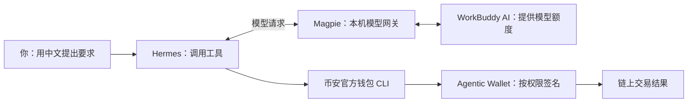

# 不买 AI 订阅，也能先体验币安 Agentic Wallet

这篇教程用 **国际 WorkBuddy AI 的免费额度 + Magpie + Hermes（爱马仕）**，搭建一个能查钱包、获取报价的钱包助手。国内 WorkBuddy 的区别放在末尾。

先记住这张图：



一句话理解：**WorkBuddy AI 提供大脑，Magpie 负责接线，Hermes 负责动手，币安钱包负责签名。**

## 1．准备两个自己的账号

先准备：

- 一台 Windows、Mac 或 Linux 电脑。
- 一个 [WorkBuddy AI 国际版](https://www.workbuddy.ai/) 账号。
- 已有 Agentic Wallet 功能的币安 App 和本人账号。能否开通以你的 App 和所在地区为准。
- [Node.js 24 LTS](https://nodejs.org/)，这是运行安装脚本的工具，按官方安装程序提示安装即可。

国际版官方订阅政策目前列出：Free 版每月 100 积分；新用户首次登录赠送 250 积分，有效期 14 天。额度、模型和活动会调整，请看本人账号的套餐页面。[官方订阅说明](https://www.codebuddy.ai/docs/zh/ide/Account/Subscription)

**本教程不需要为了试用去开通绑卡、自动续费的 Pro 体验。** 免费额度用完，可以先停用，或由你自行决定是否付费。

免费的是模型额度体验。真实买币需要本金，也可能产生 Gas 和钱包服务费；Magpie 不会让这些费用消失。

## 2．下载入门包，运行安装

从本文配套项目下载 ZIP，解压到一个你自己能找到的文件夹。Windows 尽量使用较短路径，例如 `C:\wallet-starter`，避免过长路径影响依赖安装。

在这个文件夹打开终端：Windows 可以在文件夹空白处右键“在终端中打开”；Mac 可以先打开终端，输入 `cd `，把文件夹拖进去，再回车。

运行：

```bash
node starter.mjs install
```

也可以用 Windows 的 `install.ps1` 或 Mac/Linux 的 `sh install.sh`。建议新手先用上面那条，两边写法相同。

安装内容包括 Hermes、Magpie CLI、币安钱包 CLI 和两份官方钱包技能。安装器会先校验下载文件；第一次需要下载运行环境，请保持终端开着，等它明确提示完成。

想先看看它准备做什么，可以运行：

```bash
node starter.mjs install --dry-run
```

这一阶段不需要登录币安，也不会产生交易。

## 3．把 WorkBuddy AI 登录到 Magpie

运行：

```bash
node starter.mjs workbuddy-login
```

脚本会添加 Magpie 社区的 WorkBuddy 登录插件，并使用**浏览器登录**方式打开厂商授权页面。只登录你自己的账号，按页面提示完成。

这里有两个不同的授权，别混淆：

- 现在登录 **WorkBuddy AI**：让 Magpie 使用你的模型额度。
- 稍后登录 **币安 Agentic Wallet**：让钱包工具在授权范围内操作钱包。

Magpie 插件由社区维护，并非腾讯官方宣布支持的通用 API。账号能否通过它调用，要以实际测试和服务条款为准；出现“不支持渠道”或账号限制时应停止，不要把它当成绕过限制的工具。[插件说明](https://github.com/magpie-community/plugins/tree/main/packages/workbuddy)

## 4．选一个账号能用的模型

打开 Magpie 本地页面：

```bash
node starter.mjs magpie-ui
```

保持这个终端运行。页面通常会自动打开；没有自动打开，就使用终端给出的**本机链接**。页面里的账号信息只留在自己电脑上。

在页面核对：登录的是不是正确账号、还剩多少额度、可选模型有哪些。不要在教程里照抄别人截图中的模型名称，目录会变化。若已有付费供应商或备用路由，确认本次没有选择它们。

另开一个终端，进入同一项目文件夹，查看模型完整 ID：

```bash
node starter.mjs models
```

从列表复制一个 `workbuddy-ai/…` 的 ID，然后设置：

```text
node starter.mjs set-model workbuddy-ai/这里换成真实模型ID
```

这条命令配置的是本项目的独立 Hermes 助手。执行成功只代表配置完成；还需要下面的聊天测试验证账号能否调用该模型。

## 5．启动 Hermes，先测试一句话

```bash
node starter.mjs agent
```

看到聊天界面后，发一句：

```text
请用中文回复“模型连接正常”，先不要调用钱包工具。
```

模型能正常回复，就说明这次调用链路可用；这不证明将来每个模型都能免费使用。可以回 WorkBuddy AI 的用量页面核对实际积分消耗。

Magpie 网关需要保持运行。以后开电脑，先开 `magpie-ui`，再开 `agent` 即可。不要为了体验这条路线去购买 Claude、ChatGPT 或其他无关订阅。

## 6．让 Hermes 连接币安钱包

把下面这段话发给 Hermes：

```text
请读取 binance-agentic-wallet 技能，以及它引用的 preflight 和 authentication 说明。
本项目工具通过 node starter.mjs baw <官方CLI参数> 调用；扫码登录可用 node starter.mjs wallet-login。
帮我连接本人的币安 Agentic Wallet，完整显示登录链接和配对码。
我会在币安 App 中核对并确认。验证进程保持运行，直到成功或超时。
成功后检查 wallet status，只有 CONNECTED 才算完成；然后只显示 BSC 钱包地址。
不要买币、转账、授权代币或修改钱包设置。
```

你也可以自己在终端运行：

```bash
node starter.mjs wallet-login
node starter.mjs wallet-address
```

在币安 App 中核对电脑显示的配对码，再确认。二维码失效就重新生成，不要反复使用旧二维码。若还没有 Agentic Wallet，先按币安 App 的指引创建。

**登录成功的标志是本机返回 `CONNECTED`。** App 显示成功、电脑却未连接时，应重新发起登录。[币安官方认证说明](https://github.com/binance/binance-skills-hub/blob/main/skills/binance-web3/binance-agentic-wallet/references/authentication.md)

## 7．先体验查地址、余额和报价

没有充值，也可以先查地址和连接状态。需要充值时，只向你亲自核对的**本人 Agentic Wallet 地址**转入对应链资产。

查余额：

```text
请查询我的 BSC 钱包余额，并列出代币的完整合约地址。只查询，不交易。
```

查报价：

```text
请报价：在 BSC 链上，用 0.0001 BNB 兑换 USDT，合约是
0x55d398326f99059fF775485246999027B3197955。
滑点上限 1%。只显示预计收到数量和可取得的费用信息，不提交订单。
```

也可以直接运行只读报价命令：

```bash
node starter.mjs quote --amount 0.0001 --token 0x55d398326f99059fF775485246999027B3197955
```

如果接口说金额过小或没有路由，不代表安装失败，也不要让 AI 擅自提高金额。

到这里，你已经体验了“用 AI 操作钱包工具”。不需要为了证明安装成功而买某个 Meme 币。

## 8．真要买币，再单独确认

下面是**准备交易**的提示词，不是安装步骤：

```text
我准备在 BSC 链用【填入金额】BNB 买【填入完整代币合约】。
请先做官方安全检查，核对合约、余额、报价、滑点和费用；不要凭代币名称猜地址。
先把交易参数和风险展示给我，等我明确确认后才能提交。
若审计不可用、滑点变高、额度不足或交易被拒绝，先说明情况，不要自动绕过或提高金额。
提交后核对最终状态、交易哈希和实际到账数量；只有链上成功才能说买到了。
```

普通 DEX 兑换不需要为本教程提前开启开发者模式。项目自定义的合约调用才可能需要；应先解释具体调用，完成预览，再由用户决定是否开启和签名。

## 国内 WorkBuddy 有什么不同？

使用 [国内官网](https://www.codebuddy.cn/work/) 的账号，登录命令改成：

```bash
node starter.mjs workbuddy-login --region cn
```

模型 ID 对应 `workbuddy/…`，不是 `workbuddy-ai/…`。两个地区的账号、额度和模型目录不要混用。

国内官方目前列出体验版每月 500 积分，但定价表把 CLI 访问列为付费权益。因此**不能从“有免费积分”直接推导出“Magpie 桥接一定能免费调用”**。遇到限制，先使用原生 WorkBuddy 客户端体验，或等待官方支持；不需要为了跟教程继续往下走而付费。[国内定价](https://www.codebuddy.cn/docs/workbuddy/Pricing)

## 不会操作，能不能交给豆包？

可以让豆包帮助理解步骤。若你使用的 AI 具有电脑和终端权限，把本项目与 [安装提示词](AI-INSTALL-PROMPT.md) 一起交给它，可以让它代装。

若只是普通网页聊天，它不能直接操作你的本机终端。它可以教你复制哪条命令，但不能凭一句“已经安装”就算完成。

币安 App 中的扫码确认、权限设置和最终交易确认仍需要你完成。不要把助记词、私钥、登录文件发给 AI 或教程作者。
